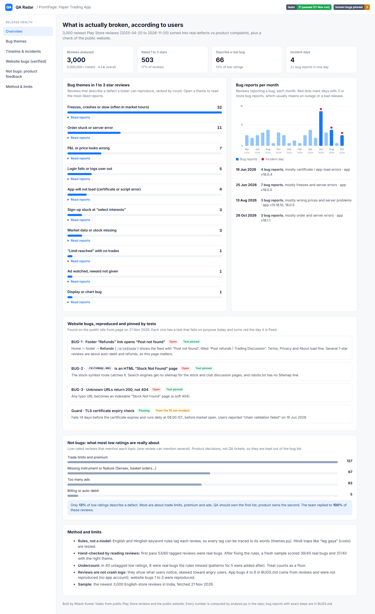

# QA Radar for FrontPage



**Problem:** FrontPage's low ratings mix real defects with complaints about limits and ads. A tester needs the first list, ranked, with steps, and checks that stop the same bug coming back.

**Result:**
- **Reviews:** only 13% of 1 to 3 star reviews describe a defect. The top bug themes are freezes in market hours, order and server errors, and wrong P&L or prices.
- **Incidents:** two show up on specific days. On 19 Jun 2026, users hit certificate "chain validation failed" errors. On 25 Jun 2026, the largest cluster of server errors in 19 months.
- **Website:** 3 bugs found and reproduced on the public site, each pinned by a test. The most important: the footer **Refunds** link opens "Post not found".

**Try it:** open `demo/index.html` in a browser; no install. A live link will be added once it is deployed. Full bug reports with steps are in [BUGS.md](BUGS.md).

## What is here

| File | What it does |
|---|---|
| `themes.py` | English and Hinglish rules that tag a review as a QA bug theme or as product feedback. Every tag traces back to its words. |
| `analysis.py` | Counts themes, monthly trend, app versions, and incident days (3 or more bug reports in a day). Writes `out/summary.json` and `demo/data.js`. |
| `tests/test_themes.py` | 14 offline tests on real-style reviews, including Hindi traps ("lag gaya" means costs, not lag) and feature asks that must not count as bugs. |
| `tests/test_web_live.py` | Live smoke tests on front.page: key pages load; strict-xfail tests for the 3 known bugs, which turn red the day each is fixed; a TLS certificate expiry guard (fails 14 days early). |
| `.github/workflows/ci.yml` | Offline tests on every push; live smoke daily at 08:00 IST, before market open. The CI badge goes live once the repo is pushed. |
| `BUGS.md` | Six bug reports. Three website bugs reproduced by me; three app bugs from user reports, clearly marked as not reproduced. |

## Checks on my own work

- **Hand-checked by reading the reviews.**
  - First pass: 53 of 60 tagged reviews were real bugs, and 51 had the right theme. The misses were Hindi words matching "lag", and feature requests such as basket orders or partial exit.
  - After fixing the rules, a fresh sample of 40: 39 real bugs, 37 with the right theme.
- **Undercount.** In 40 untagged low ratings, 8 were real bugs the rules missed (for example "MCX data temporarily unavailable", certificate errors). I added patterns for 5 of them. The counts are a floor, not a total.
- **Test status (local run, 21 Nov 2026):** 21 passed, 3 expected failures (the known bugs).

## Limits

- Reviews show what users notice, skewed toward angry users. They are not crash logs. Crashlytics or backend error rates would be the source of truth.
- App bugs 4 to 6 come from reviews and were not reproduced: I have no FrontPage account or test build.
- The sample is the newest 3,000 English reviews on the India Play Store (Apr 2025 to Nov 2026). iOS was not included.

## Run

```
pip install google-play-scraper pandas pytest
python fetch_reviews.py                    # writes data/reviews_raw.json (not committed)
python analysis.py
python -m pytest -q tests/test_themes.py   # offline
LIVE=1 python -m pytest -v tests/          # adds live checks against front.page (a few read-only requests)
```
